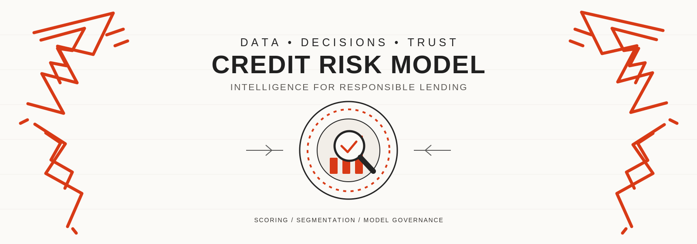
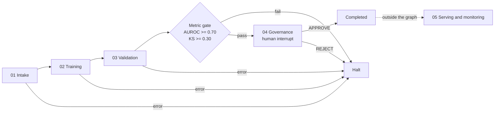

<p align="center">
  
</p>

<h1 align="center">Credit Risk Model</h1>

<p align="center">
  
  <a href="https://github.com/DataDynamoShweta/Credit_Risk_Model/actions/workflows/ci.yml"></a>
</p>

Credit risk scorecard pipeline with LangGraph agent orchestration, FastAPI serving, and a human governance gate. Demonstration project only; not for production credit decisions.

<a id="pipeline-at-a-glance"></a>
## Pipeline at a glance

The graph is linear. Any stage failure goes to `halt`. The metric gate fails when `AUROC < 0.70` or `KS < 0.30`. Approval is a human interrupt. Serving and monitoring are outside the LangGraph graph.



The graph uses `MemorySaver` (in memory). There is no SQLite checkpointer. `PipelineRunner` calls `pipelines.train.main` and `pipelines.validate.main` in-process; it does not spawn a subprocess.

LLM commentary order in `credit_risk_agents/tools/llm_client.py`:

1. Azure OpenAI, if `AZURE_OPENAI_API_KEY` and `AZURE_OPENAI_ENDPOINT` are set (default model `gpt-4.1`).
2. Local Hugging Face model in `models/Qwen2.5-3B-Instruct` or `HF_MODEL_DIR`.
3. Rule-based fallback.

Ollama is not used. The LLM writes commentary only; it does not control gates. The local model is 3B-class (Qwen/Qwen2.5-3B-Instruct).

<table>
<tr>
<td width="34%" valign="top">

</td>
<td valign="top">
<b>Data intake and profiling.</b><br>
Load synthetic or LendingClub data; inspect schema, missingness, target, date coverage, leakage and quality.<br>
<b>Agents:</b> Data Quality; Target and Leakage.
</td>
</tr>
</table>

<table>
<tr>
<td valign="top">
<b>Training.</b><br>
Fold-safe preprocessing, feature contract, WoE/IV review. Champion is logistic regression; challenger is tree-based.<br>
<b>Agents:</b> Feature Engineering; Modeling; Challenger; Experiment Tracking.
</td>
<td width="34%" valign="top" align="right">

</td>
</tr>
</table>

<table>
<tr>
<td width="34%" valign="top">

</td>
<td valign="top">
<b>Independent validation and stress tests.</b><br>
Discrimination, calibration, OOT/vintage, bootstrap CIs, stability, sensitivity and limitations.<br>
<b>Agents:</b> Validation; Model Risk Reviewer.<br>
<b>Cohort separation:</b> the train/test/OOT split is implemented once in <code>validation/suite.py::split_dataset</code> and shared by training and validation.
</td>
</tr>
</table>

<table>
<tr>
<td valign="top">
<b>Metric gate and governance gate.</b><br>
Gate: <code>AUROC &lt; 0.70</code> or <code>KS &lt; 0.30</code> goes to halt. Otherwise the graph pauses at a human interrupt. <code>APPROVE</code> completes; <code>REJECT</code> halts.<br>
<b>Agents:</b> Governance; Model Risk Reviewer; Explainability.
</td>
<td width="34%" valign="top" align="right">

</td>
</tr>
</table>

<table>
<tr>
<td width="34%" valign="top">

</td>
<td valign="top">
<b>Serving, monitoring and handoff.</b><br>
Feature-contract validation, FastAPI endpoints, audit logging, unit/integration tests, PSI/CSI monitoring, CI/CD checks and run manifest.<br>
<b>Agents:</b> API Engineer; QA and Test; Monitoring; DevOps; Report and Handoff.<br>
This stage is outside the LangGraph graph.
</td>
</tr>
</table>

<table>
<tr>
<td valign="top">
<b>Capabilities.</b><br>
Agentic orchestration; human approval gate; hash-chained audit trail; monitoring.
</td>
<td width="34%" valign="top" align="right">

</td>
</tr>
</table>

<a id="quick-start"></a>
## Quick Start

Requires Python 3.10 or later; the Windows `setup_and_run.bat` launcher supports Python 3.10–3.13 only.

```bash
python -m venv .venv
source .venv/bin/activate        # Linux/macOS
# .venv\Scripts\activate         # Windows

pip install -e ".[dev]"
cp .env.example .env

python pipelines/train.py
python pipelines/validate.py --bootstrap 50

uvicorn api.main:app --reload
```

Open http://localhost:8000/planner and http://localhost:8000/docs.

The LLM extras (`torch`, `transformers`; large) are not in `pyproject.toml`. Install them with:

```bash
pip install -r requirements.txt
```

Run tests:

```bash
pytest
```

Last observed result: `169 passed, 1 skipped` on Python 3.11 (about 2 minutes). Re-run to confirm.

Real data:

```bash
git lfs pull
python pipelines/train.py --data loan_data_2015.csv --adapter lending_club
python pipelines/validate.py --data loan_data_2015.csv --adapter lending_club
```

<a id="contents"></a>
## Contents

- [Pipeline at a glance](#pipeline-at-a-glance)
- [Quick Start](#quick-start)
- [API reference](#api-reference)
- [Validation](#validation)
- [Governance](#governance)
- [Monitoring](#monitoring)
- [CI/CD and Docker](#cicd-and-docker)
- [Data, privacy and security](#data-privacy-and-security)
- [Known limitations](#known-limitations)
- [Roadmap](#roadmap)
- [Original notebook](#original-notebook)

<a id="api-reference"></a>
## API reference

| Method | Path | Purpose | Notes |
|---|---|---|---|
| GET | `/health` | Health check | |
| POST | `/predict` | Score one applicant | |
| GET | `/model-card` | Model card | |
| GET | `/audit/decisions`, `/audit/changes`, `/audit/adjustments`, `/audit/monitoring`, `/audit/verify` | Audit records and chain verification | Disabled unless `AUDIT_API_TOKEN` is set (403 otherwise) |
| POST | `/workflows/credit-risk/run` | Start a workflow | Returns HTTP 202 |
| GET | `/runs/{run_id}` | Run status | `run_id` already starts with `crw-` |
| GET | `/runs/{run_id}/events` | Run events | |
| GET | `/runs/{run_id}/artifacts` | Artifact manifest | |
| GET | `/runs/{run_id}/artifacts/{name}` | Download artifact | |
| POST | `/workflows/credit-risk/{run_id}/approve` | Governance decision | Alias: `/approval` |
| GET | `/`, `/planner` | Frontend | |

### Score one applicant

```bash
curl -X POST http://localhost:8000/predict \
  -H 'Content-Type: application/json' \
  -d '{
    "loan_amnt": 15000,
    "int_rate": 11.5,
    "annual_inc": 75000,
    "dti": 18.2,
    "emp_length": 6,
    "home_ownership": "MORTGAGE"
  }'
```

Observed response on a local run (values depend on the trained model; `request_id` omitted):

```json
{
  "probability_of_default": 0.0302,
  "score": 587,
  "model_name": "credit_risk_champion",
  "model_version": "1.3.0"
}
```

### Start a workflow

```bash
curl -X POST http://localhost:8000/workflows/credit-risk/run \
  -H 'Content-Type: application/json' \
  -d '{
    "dataset": "synthetic",
    "target": "target",
    "champion": "logistic_regression",
    "challenger": "hist_gradient_boosting",
    "oot_pct": 20,
    "seed": 42
  }'
```

Returns HTTP 202 with `run_id`, `events_url` and `artifacts_url`. Check status with `curl http://localhost:8000/runs/<run_id>`. `GET /workflows/credit-risk/<run_id>` returns 404; use `/runs/<run_id>`.

Approve or reject:

```bash
curl -X POST http://localhost:8000/workflows/credit-risk/<run_id>/approve \
  -H 'Content-Type: application/json' \
  -d '{"decision":"APPROVE","comment":"Reviewed","reviewer_id":"mro_officer_01"}'
```

Approval is enforced by the LangGraph interrupt. The workflow endpoints have no authentication, `reviewer_id` is client-supplied, and CORS allows all origins. RBAC is future work.

<a id="validation"></a>
## Validation

| Area | What is checked | Reference |
|---|---|---|
| Split | Chronological train/test/OOT split in `validation/suite.py::split_dataset`, shared by training and validation | OOT holdout default 20% |
| Discrimination | AUROC, KS | 20,000 synthetic rows: held-out AUROC ≈ 0.71 |
| Calibration | Calibration ratio | ≈ 1.01 |
| PSI/CSI | Population and characteristic stability | See [Monitoring](#monitoring) |
| OOT | Out-of-time performance | OOT AUROC ≈ 0.72 |
| Vintage | Vintage-level performance | Reported by validation suite |
| Champion–challenger | Comparison on equivalent splits | Reported by validation suite |
| Sensitivity | Stress and sensitivity checks | Reported by validation suite |
| WoE/IV | Feature review | Reported by validation suite |
| Not assessed | Conceptual soundness; fair-lending analysis; independent model-risk sign-off; production backtesting | Not claimed |

Reference values come from `python pipelines/train.py && python pipelines/validate.py --bootstrap 50` (held-out AUROC 0.7072, calibration ratio 1.009, OOT AUROC 0.716). The agent layer's metrics are not all measured; see [Known limitations](#known-limitations).

<a id="governance"></a>
## Governance

- `governance/model_inventory.yaml` gates serving.
- `governance/pma_log.csv` records model approvals.
- The audit trail is hash-chained.
- `.github/CODEOWNERS` defines review ownership.
- The human approval gate is a LangGraph interrupt that pauses the graph before completion.
- Inventory approval fields are not evidence of independent validation.

See [docs/GOVERNANCE.md](docs/GOVERNANCE.md) and [docs/AUDIT_TRAIL.md](docs/AUDIT_TRAIL.md).

<a id="monitoring"></a>
## Monitoring

| PSI/CSI | Action |
|---|---|
| < 0.10 | OK |
| 0.10–0.25 | Investigate |
| ≥ 0.25 | Escalate |

Exit codes: 0 ok, 1 investigate, 2 escalate, 3 input error.

```bash
python scripts/generate_synthetic.py --rows 5000 --seed 42 --out data/reference.csv
python scripts/generate_synthetic.py --rows 5000 --seed 43 --drift 0.15 --out data/current.csv
python pipelines/monitor.py --reference data/reference.csv --current data/current.csv
```

See [docs/MONITORING.md](docs/MONITORING.md).

<a id="cicd-and-docker"></a>
## CI/CD and Docker

| File / command | Purpose |
|---|---|
| `.github/workflows/ci.yml` | Lint (ruff), tests (pytest), Docker build and smoke job |
| `.github/workflows/cd.yml` | Package and deploy workflow |
| `.github/workflows/monitoring.yml` | Scheduled monitoring/drift check |
| `docker compose up --build` | Local container run; currently blocked |

Docker is blocked: the Dockerfile does not copy `credit_risk_agents/` or `frontend/`, so the image fails at start-up with `ModuleNotFoundError: No module named 'credit_risk_agents'`. See [docs/CI_CD.md](docs/CI_CD.md).

<a id="data-privacy-and-security"></a>
## Data, privacy and security

- No raw rows in logs or audit records.
- Secrets come only from environment variables.
- Model artefacts are pickles. Verify integrity with `MODEL_SHA256`.
- Never set `ALLOW_UNREVIEWED_MODEL=true` outside local demos.

<a id="known-limitations"></a>
## Known limitations

- **Agent-layer metrics are not all measured.** In `credit_risk_agents/tools/pipeline_runner.py::_extract_metrics`, AUROC comes from the champion's hold-out metadata, but if it is below 0.70 it is replaced with 0.742. KS is `max(0.35, auroc * 0.5)`. Brier (0.108) and PSI (0.038) are constants. A real run on the same data gave hold-out AUROC 0.683 and KS 0.305 in `validation_report.md`. As written, the `AUROC < 0.70 or KS < 0.30` gate cannot fail. `test_report.json` and the CSI values in `drift_summary.json` are hard-coded, and the generated `model_card.json` states `"independent_validation": "PASSED"`. Do not treat these as measured evidence.
- Workflow run state is in memory (`MemorySaver`) and is lost on restart.
- Workflow endpoints are unauthenticated; reviewer identity is client-supplied.
- Synthetic workflow runs use 4,000 rows; `pipelines/train.py` defaults to 20,000.
- Synthetic data only; no conceptual-soundness review.
- Real data (LendingClub) is a biased resolved-loan sample.
- MLflow and WeasyPrint tests are mocked.
- The audit trail is tamper-evident, not tamper-proof.

<a id="roadmap"></a>
## Roadmap

- [x] Synthetic training and validation pipeline
- [x] FastAPI serving
- [x] LangGraph orchestration with human approval interrupt
- [ ] Replace hard-coded agent metrics with measured validation output
- [ ] Add authentication and RBAC to workflow endpoints
- [ ] Add persistent checkpointing
- [ ] Fix Dockerfile to copy `credit_risk_agents/` and `frontend/`
- [ ] Add conceptual-soundness and fair-lending review

<a id="original-notebook"></a>
## Original notebook

See [notebooks/Final.ipynb](notebooks/Final.ipynb). Its flaws are listed in [notebooks/README.md](notebooks/README.md). The notebook is not the production pipeline.
